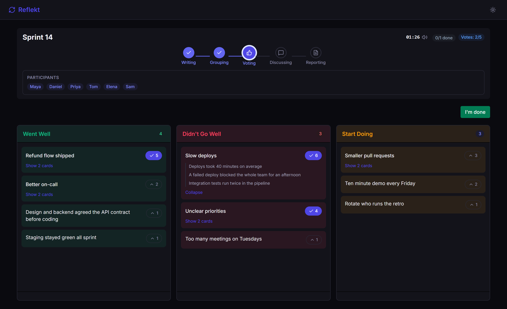
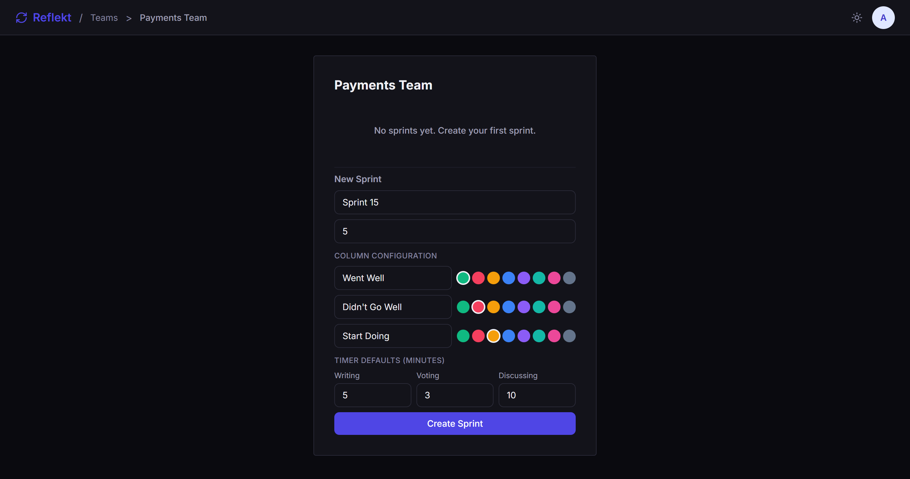
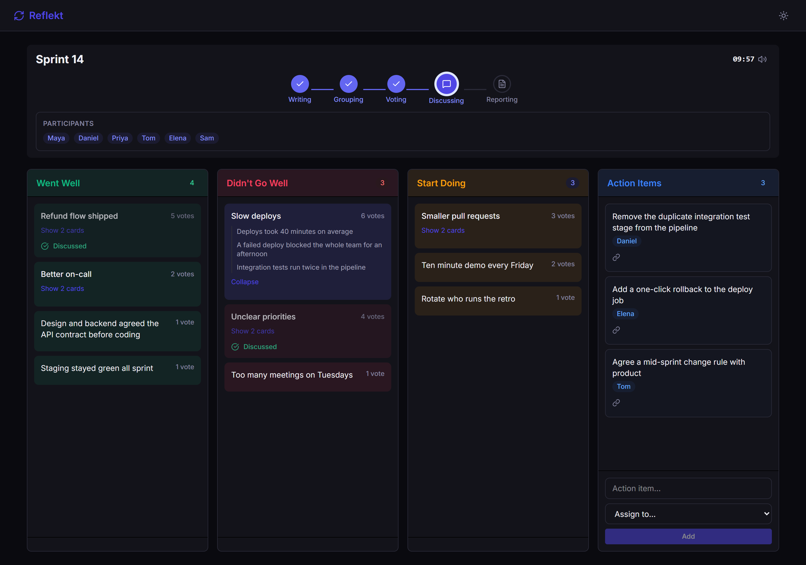
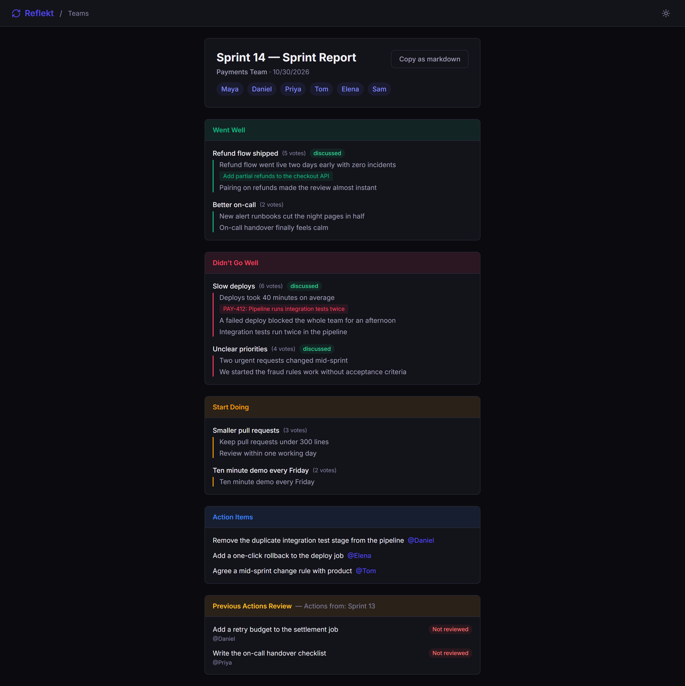

# Reflekt

**A real-time sprint retrospective board, built entirely by AI agents.**

Reflekt takes a team from "what went well?" to a list of assigned action items in one live session: everyone writes, groups and votes in the same room, and the board updates for all of them as it happens. The repo is also a teaching example. Every feature was specified, planned, implemented and reviewed by [Claude Code](https://docs.anthropic.com/en/docs/claude-code) agents, and the records of that work are kept here next to the code.

    



## Why this repo

| If you want... | You get... |
|---|---|
| **A retro tool** | A complete app for small teams: no accounts for participants, just a join link. Deploys to a single Azure App Service. |
| **To see how agents build software** | A full application, not a demo, with the specs, plans, reviews and lessons behind each feature. Start at [How it was built](#how-it-was-built). |
| **A .NET and Vue reference** | Domain-driven design with vertical slices, domain events and real-time updates, in a codebase small enough to read. Start at the [architecture map](docs/architecture/index.md). |

## How a retro runs

A Scrum Master signs in with Google, creates a team and a sprint, and shares the link. Participants join with a display name or their Google account. The retro then moves through five phases:

```
Writing ──▶ Grouping ──▶ Voting ──▶ Discussing ──▶ Reporting
```

| Phase | What happens |
|---|---|
| **Writing** | Everyone adds cards to the columns. Other people's card text stays hidden until the phase ends, so nobody anchors on the first opinion. |
| **Grouping** | Drag similar cards together and give the group a title. |
| **Voting** | Everyone spends a set number of votes on the groups that matter most. |
| **Discussing** | The Scrum Master brings one group into focus at a time and marks it discussed when the team is done. Action items go on the board as you talk, each with an assignee. |
| **Reporting** | A report of the whole retro, which can be copied as Markdown. |

<table>
  <tr>
    <td width="50%"><a href="docs/images/sprint-setup.png"></a></td>
    <td width="50%"><a href="docs/images/discussing.png"></a></td>
  </tr>
  <tr>
    <td align="center"><b>Set up the sprint:</b> columns, colors, votes and timers</td>
    <td align="center"><b>Discuss:</b> one group at a time, action items as you go</td>
  </tr>
</table>

<details>
<summary><b>See the final report</b></summary>
<br>

</details>

## Features

| Feature | What it does |
|---|---|
| **Live room** | Cards, groups, votes, focus and phase changes reach everyone at once over SignalR. |
| **Configurable columns** | Name and color each of the three columns per sprint. |
| **Dot voting** | A vote budget per participant, set per sprint. Everyone sees the counts; nobody sees who voted for what. |
| **Evidence links** | Attach Jira issues, pull requests, commits or any link to a card. Title and details are fetched in the background. |
| **Phase timer** | A countdown for each phase, with defaults per sprint and an optional chime. |
| **Readiness** | Participants press "I'm done", so the Scrum Master can see when to move on. |
| **Action follow-up** | Action items from the last retro come back at the next one, to be marked done, carried over or dropped. |
| **Light and dark themes** | Plus a tabbed layout for phones. |

## Architecture at a glance

One ASP.NET Core service serves the API, the SignalR hub and the built Vue app, backed by one SQLite file.

```
Browser (Vue 3 + Pinia)
   │  HTTP (FastEndpoints)        SignalR (/hubs/sprint)
   ▼                                   ▲
Reflekt.API ── feature slices ─────────┤ domain event handlers broadcast
   │                                   │
   ▼                                   │
Reflekt.Domain ── aggregates raise domain events
   │
Reflekt.Persistence ── EF Core + SQLite; events publish after the save
```

| Layer | Stack |
|---|---|
| **Backend** | .NET 10, ASP.NET Core, [FastEndpoints](https://fast-endpoints.com/), FluentValidation, Mapster, SignalR |
| **Data** | EF Core 10 with SQLite; migrations apply on start-up |
| **Sign-in** | Google OAuth with cookies for signed-in users, guest tokens for participants |
| **Frontend** | Vue 3, TypeScript, Pinia, Tailwind CSS 4, built with Vite into the API's `wwwroot/` |
| **Tests** | xUnit, FluentAssertions, `WebApplicationFactory` |

The [architecture map](docs/architecture/index.md) is one page and links to the [full reference](docs/architecture/architecture.md).

## Quick start

You need the [.NET 10 SDK](https://dotnet.microsoft.com/download) and [Node.js](https://nodejs.org/) 20.19+ or 22.12+.

**1. Set the Google credentials.** The app won't authenticate requests without them, even for guests. Any text works if you only want to try it as a guest:

```powershell
cd src/Services/Reflekt/Reflekt.API
dotnet user-secrets set "Auth:Google:ClientId" "placeholder"
dotnet user-secrets set "Auth:Google:ClientSecret" "placeholder"
```

**2. Start the API**, from the same folder. It creates the database by itself and listens on `http://localhost:4001`.

```powershell
dotnet run
```

**3. Start the frontend** in a second terminal, from the repository root, then open `http://localhost:5173`.

```powershell
cd web/reflekt-web
npm install
npm run dev
```

<details>
<summary><b>Real Google sign-in</b></summary>
<br>

To sign in as a Scrum Master you need real values. In the [Google Cloud Console](https://console.cloud.google.com/), under APIs & Services → Credentials, create an OAuth 2.0 Client ID of type Web application. Add these as authorized redirect URIs:

- `http://localhost:5173/signin-google` (Vite dev server)
- `http://localhost:4001/signin-google` (API directly)

Store the client ID and secret with the `dotnet user-secrets` commands above. Never put them in `appsettings*.json`.
</details>

<details>
<summary><b>Sample data</b></summary>
<br>

In the Development environment you can seed a team, a sprint and a few participants. Use the Google email you sign in with, so the seeded team is yours. From `src/Services/Reflekt/Reflekt.API`:

```powershell
dotnet user-secrets set "Seed:Enabled" "true"
dotnet user-secrets set "Seed:SeedUserEmail" "you@example.com"
```
</details>

### Tests and build

From the repository root:

```powershell
# Backend: unit and integration tests
dotnet test Reflekt.slnx

# Frontend: type-check and production build, output goes to the API's wwwroot/
cd web/reflekt-web
npm ci
npm run build
```

### Deploy

`deploy.ps1` builds the frontend, publishes the API and deploys it to an Azure App Service (Linux). Both parameters are required, so it can never target a default app:

```powershell
.\deploy.ps1 -AppName <APP_NAME> -ResourceGroup <RESOURCE_GROUP>
```

Creating the Azure resources, the app settings and the OAuth redirect URIs is covered in [docs/deployment-azure.md](docs/deployment-azure.md).

## How it was built

Reflekt was built by AI agents working as a team, with a human owner deciding what to build and approving each step. Instead of one assistant doing everything, separate agents take separate roles and hand work to each other through files:

```
Owner → PO (spec) → Architect (plan) → Developer (implement)
      → Architect (done check) + Reviewer (code review) → Done
```

The setup grew along with the app, so the repo keeps every generation of its records on purpose. They show how the app came to be; they don't describe the current code.

| Where | Generation | What you find |
|---|---|---|
| `ai-coding/` | First | The original agent setup and per-feature folders: usually a plan, a review, lessons and a delivery record |
| `docs/features/` + `docs/plans/` | Second | Feature specs written before planning, then their plans and delivery records |
| `docs/specs/` | Current | One folder per feature from `F29` onward, plus ad-hoc runs. `delivery/` holds the plan, implementation record, reviews, lessons and summary; `F31`, `F32` and `F35`–`F40` also have the spec in `definition/` |

The final batch, `F35`–`F40`, ran as one campaign on [Nexus](https://github.com/DotNetLabX/claude-nexus), a multi-agent pipeline for Claude Code.

### Finding your way around

| Path | What's there |
|---|---|
| `src/Services/Reflekt/` | The service: `Reflekt.API` (one folder per feature slice), `Reflekt.Domain`, `Reflekt.Persistence` |
| `src/BuildingBlocks/` | Shared libraries with no Reflekt knowledge |
| `tests/` | Unit tests for the aggregates, integration tests for the endpoints |
| `web/reflekt-web/` | The Vue app |
| `docs/product/` | The business specs |
| `docs/architecture/` | The architecture map and as-built reference; `v1.md` is the original proposal, kept as the decision log |
| `docs/conventions/` | The coding conventions the agents follow |
| `docs/backlog.md`, `docs/bugs.md` | The feature sequence, and the bugs found in user testing with their fixes |
| `CLAUDE.md`, `.claude/` | The instructions and agent setup as they were used: roles, rules, formats and skills |
| `graphify-out/` | A structural knowledge graph of the code that the agents read before answering architecture questions |

Two things in `.claude/` may look wrong but are left as they were. The skills came from a starter template, so some were never used here (gRPC, Redis, MassTransit, MediatR). And the rules mention a `docs/kb/` knowledge base and a `docs/skill-backlog.md` that were never created.

## Design decisions

Deliberate choices, not oversights:

| Decision | Why |
|---|---|
| One instance with SQLite | SignalR groups and timers live in memory, and a team's retro doesn't need more. It keeps deployment to one App Service. |
| Participants don't need accounts | A join link and a display name are the fastest way into a retro. Guests get a token; Google sign-in is optional for them. |
| Any Google account can sign in | There is no allowlist. Access is checked per team and sprint. |
| Phase rules are data | Which action each phase allows lives in a seeded table that the backend enforces and the frontend reads, so the two can't disagree. |
| Card text is hidden on the server | During Writing, other people's text is removed before it's sent, so it can't be read from the browser. |
| No repository interfaces | Each repository has one implementation, so an interface would add nothing. |
| No entity service classes | Business rules live in the aggregates. Domain events drive the real-time broadcasts. |

## License

[MIT](LICENSE)
